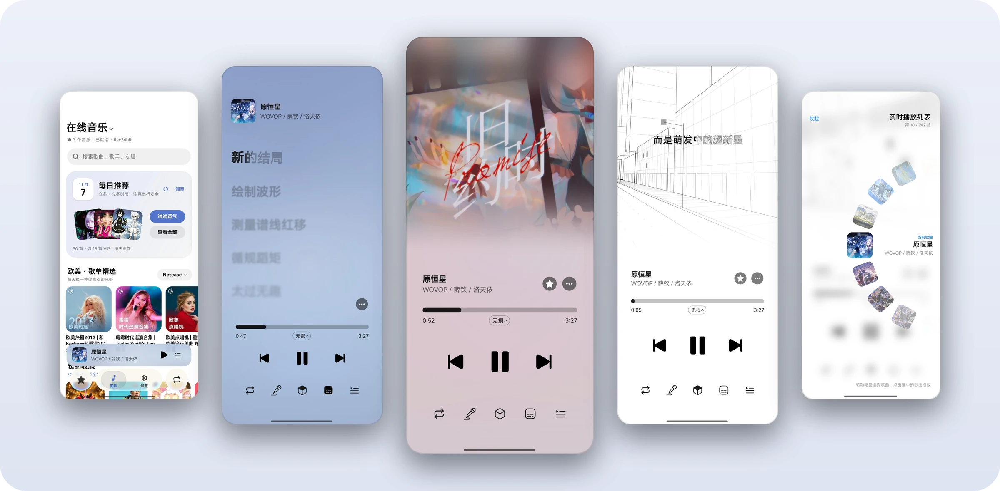
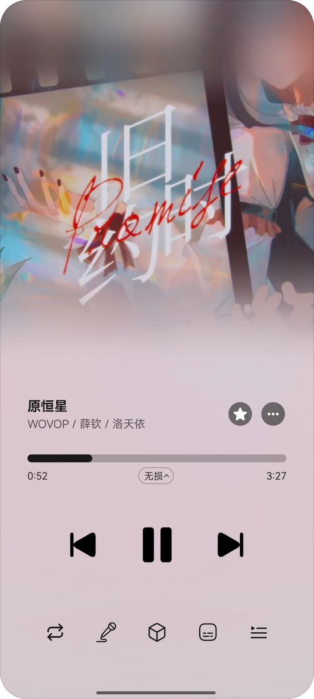
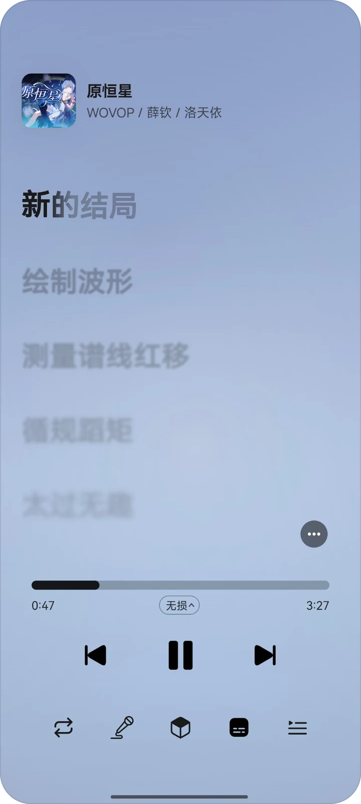
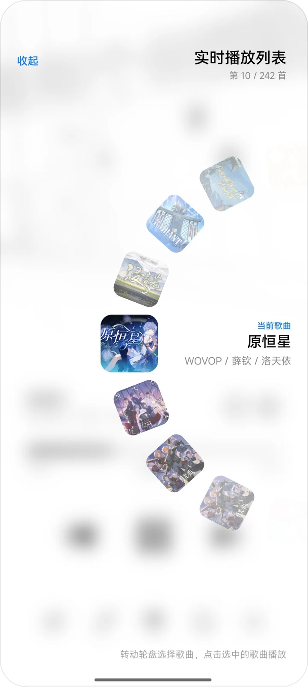
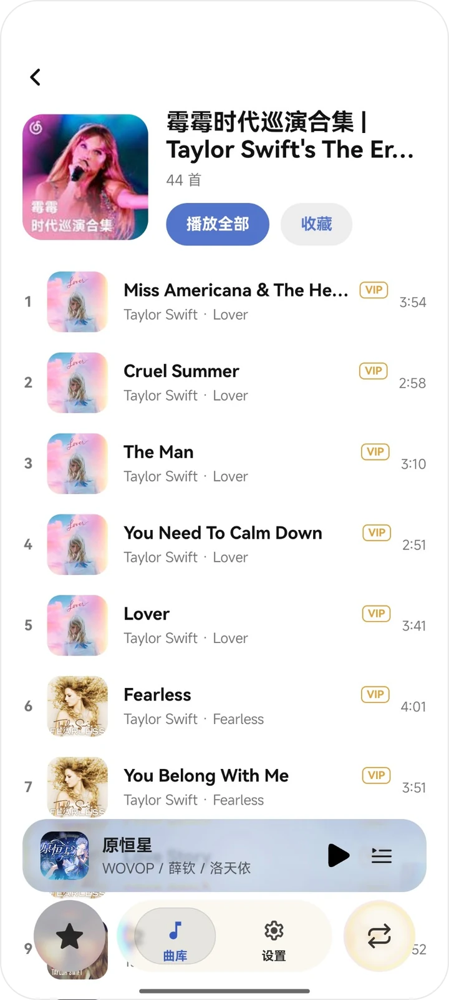
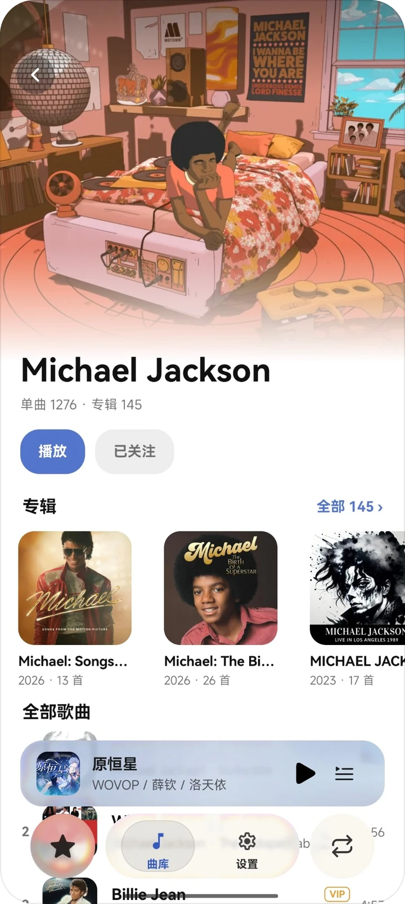
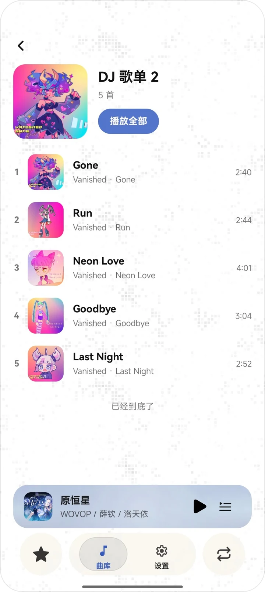
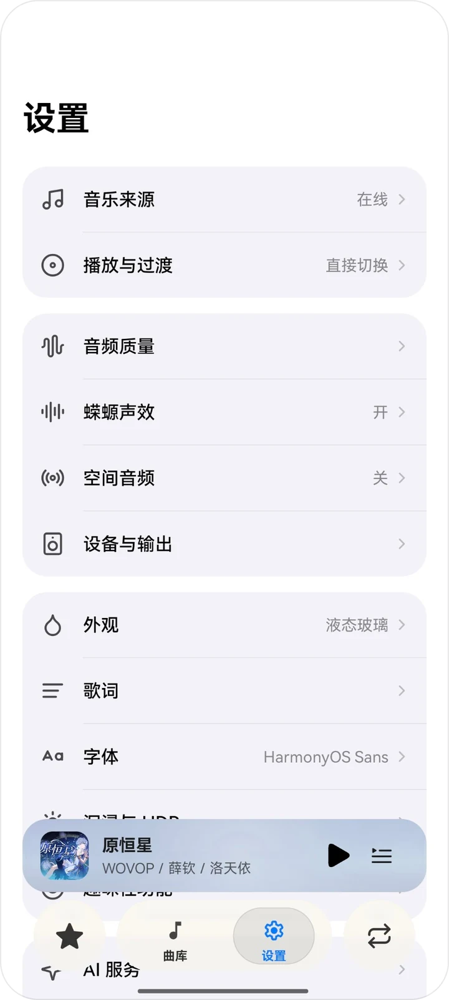
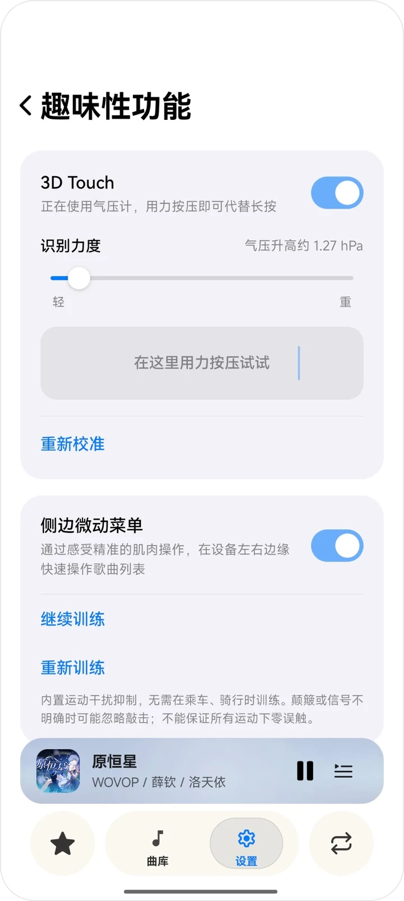
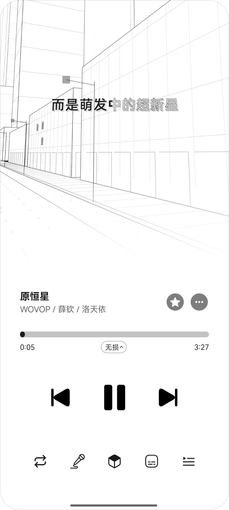

<h1>Salam Player</h1>

<b>蝾螈播放器</b>

面向本地与远程音乐库的 Android 音乐播放器

<a href="#播放">播放</a>&nbsp;&nbsp;·&nbsp;&nbsp;<a href="#音乐库">音乐库</a>&nbsp;&nbsp;·&nbsp;&nbsp;<a href="#设置">设置</a>&nbsp;&nbsp;·&nbsp;&nbsp;<a href="#superdeep-沉浸歌词">SuperDeep</a>

 

## 播放

<table>
  <tr>
    <td align="center" width="33%">  <b>沉浸封面</b> 封面与 MV 铺满上半屏，底色随封面变化  </td>
    <td align="center" width="33%">  <b>逐字歌词</b> 当前行逐字填充，其余行按距离渐隐  </td>
    <td align="center" width="33%">  <b>实时播放列表</b> 转动轮盘选择歌曲  </td>
  </tr>
</table>

 

## 音乐库

<table>
  <tr>
    <td align="center" width="25%">  <b>在线音乐</b> 每日推荐与歌单精选  </td>
    <td align="center" width="25%">  <b>歌单</b> 歌单详情与播放  </td>
    <td align="center" width="25%">  <b>艺人</b> 艺人主页、专辑与全部歌曲  </td>
    <td align="center" width="25%">  <b>DJ 歌单</b> 像素矩阵背景  </td>
  </tr>
</table>

 

## 设置

<table>
  <tr>
    <td align="center" width="50%">  <b>设置</b> 音乐来源、音频、外观与歌词分组  </td>
    <td align="center" width="50%">  <b>趣味性功能</b> 3D Touch 与侧边微动菜单  </td>
  </tr>
</table>

 

## SuperDeep 沉浸歌词

SuperDeep 把同步歌词放进实时渲染的场景中：歌词在立体空间和平面海报之间切换，镜头跟随歌曲的节拍与段落运动。画面由独立的原生渲染线程绘制，每一帧都由歌曲时间直接算出，因此进度跳转后的画面与连续播放到该处完全一致。

<table>
  <tr>
    <td align="center" width="33%">  <b>城区</b> 每句歌词对应一个街道镜头  </td>
    <td align="center" width="33%">  <b>平面海报</b> 主歌在海报版式中阅读  </td>
    <td align="center" width="33%">  <b>空间幕布</b> 竖卷排布，频谱随音乐起伏  </td>
  </tr>
</table>

新功能窗口中的演示：

<table>
  <tr>
    <td align="center" width="50%">  <b>城区</b>  </td>
    <td align="center" width="50%">  <b>空间幕布</b>  </td>
  </tr>
</table>

### 场景模式

| 模式 | 说明 |
| --- | --- |
| 智能转场 | 主歌在平面海报上阅读，副歌与标题进入立体空间，两者之间通过白块转场衔接 |
| 城区 | 整首歌在城市街道中展开，每句歌词对应一个镜头，句与句之间由镜头运动衔接 |
| 空间幕布 | 整首歌在立体空间中展开，歌词以竖卷形式排布 |
| 平面 | 整首歌以平面海报形式呈现 |

### 技术构成

| 层 | 语言 | 职责 |
| --- | --- | --- |
| 视图与调度 | Kotlin | `TextureView` 承载；歌词预处理；字形栅格化与按需上传 |
| 渲染线程 | C++ | 独立线程与 OpenGL ES 3 上下文；按垂直同步出帧；播放时钟同步；图集纹理 |
| 渲染内核 | Rust | 场景编排、镜头、投影、几何抗锯齿、顶点与绘制命令生成；字形距离场 |

- 不使用 MSAA、深度缓冲、离屏渲染或全屏后处理，每帧只有少量 draw call；
- 帧率上限 60 fps，画面静止时降为约 30 fps，暂停时停止出帧；
- 字形以距离场形式存入常驻图集，在播放过程中按距离播放位置的远近逐批生成，跨歌曲复用；
- 软边缘与浅色主题反色都在 GL 内完成，界面合成时只是一张纹理。

完整流程见 **[SuperDeep 底层渲染流程](SuperDeep/PIPELINE.md)**，包括线程模型、场景构建、字形图集、每帧步骤、着色器、混合状态、缓冲格式、时钟同步、功耗策略和生命周期。

### 代码

| 文件 | 内容 |
| --- | --- |
| [`source/android/LyricStageNative.kt`](SuperDeep/source/android/LyricStageNative.kt) | JNI 接口定义 |
| [`source/android/LyricStageView.excerpt.kt`](SuperDeep/source/android/LyricStageView.excerpt.kt) | 视图与原生渲染器的衔接、场景构建调度、字形流式上传 |
| [`source/android/SuperDeepDemoView.java`](SuperDeep/source/android/SuperDeepDemoView.java) | 新功能窗口中的预览组件 |
| [`source/native/stage_renderer.excerpt.cpp`](SuperDeep/source/native/stage_renderer.excerpt.cpp) | 渲染线程：消息模型、帧调度、时钟、EGL / GLES 资源、命令分派 |
| [`source/core/lib.excerpt.rs`](SuperDeep/source/core/lib.excerpt.rs) | 渲染内核的 C ABI |
| [`source/core/frame.excerpt.rs`](SuperDeep/source/core/frame.excerpt.rs) | 单帧输出的数据结构、绘制命令、遮罩与收尾 |
| [`source/core/sdf.rs`](SuperDeep/source/core/sdf.rs) | 字形距离场生成 |

 

本仓库内容按 <a href="LICENSE">GPL-3.0</a> 发布&nbsp;&nbsp;·&nbsp;&nbsp;<a href="https://space.bilibili.com/194639276">BiliBili</a>

