# SuperDeep 底层渲染流程

本文档描述 SuperDeep 从歌词输入到屏幕合成的完整渲染流程。

## 目录

1. [总体架构](#1-总体架构)
2. [线程模型](#2-线程模型)
3. [场景构建流程（每首歌一次）](#3-场景构建流程每首歌一次)
4. [字形图集流程](#4-字形图集流程)
5. [渲染线程消息模型](#5-渲染线程消息模型)
6. [每帧渲染流程](#6-每帧渲染流程)
7. [着色器](#7-着色器)
8. [绘制命令与混合状态](#8-绘制命令与混合状态)
9. [顶点与缓冲格式](#9-顶点与缓冲格式)
10. [播放时钟同步](#10-播放时钟同步)
11. [帧率与功耗策略](#11-帧率与功耗策略)
12. [与界面的合成](#12-与界面的合成)
13. [Surface 与 EGL 生命周期](#13-surface-与-egl-生命周期)
14. [新功能窗口中的预览](#14-新功能窗口中的预览)
15. [异常与降级](#15-异常与降级)

---

## 1. 总体架构

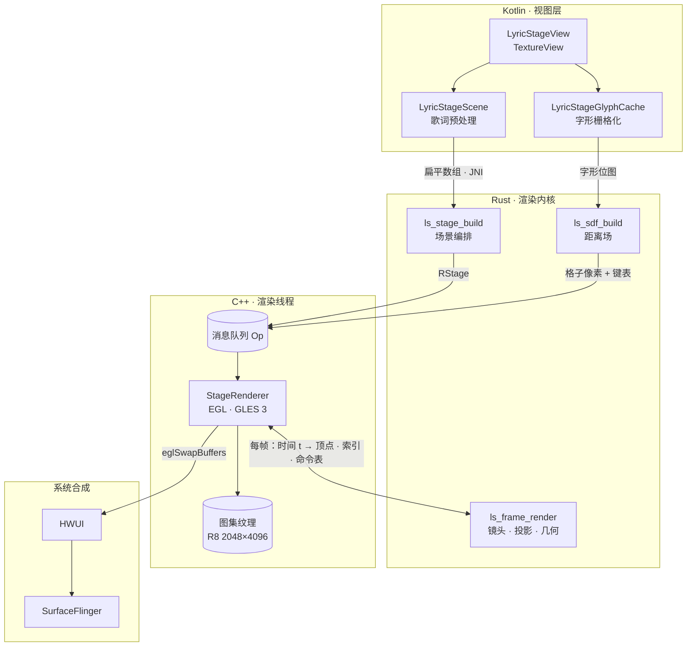

| 层 | 语言 | 所在模块 | 职责 |
| --- | --- | --- | --- |
| 视图层 | Kotlin | `LyricStageView`（`TextureView`） | 接收歌词、节拍网格、播放时钟、布局与主题；调度场景构建与字形上传；提供渲染 Surface |
| 预处理 | Kotlin | `LyricStageScene` / `LyricStageGlyphCache` | 歌词拆分为词与字素、分配时间、生成扁平数组；字形栅格化为距离场 |
| 渲染线程 | C++ | `lyric_stage_native.cpp` | 独立线程与 EGL 上下文；垂直同步调度；时钟；图集纹理；把 Rust 输出的顶点数据提交给 GPU |
| 内核 | Rust | `rust/lyricstage`（链接进 `libsalam_native.so`） | 场景编排、镜头、投影、几何抗锯齿、顶点与绘制命令生成；距离场变换；不调用图形 API |
| 合成 | 系统 | HWUI / SurfaceFlinger | 把 `TextureView` 作为一张纹理合成进界面 |

核心约束：

- 场景在加载时一次性编排，之后每一帧都是歌曲时间 `t` 的纯函数。拖动进度后看到的画面与连续播放到该时刻完全一致。
- 一帧只有少量 draw call，不使用 MSAA、深度缓冲、离屏渲染或全屏后处理。抗锯齿和辉光来自几何本身与字形距离场。
- 整首歌不预渲染。新歌的场景立刻可用，字形在播放过程中按需生成。

## 2. 线程模型

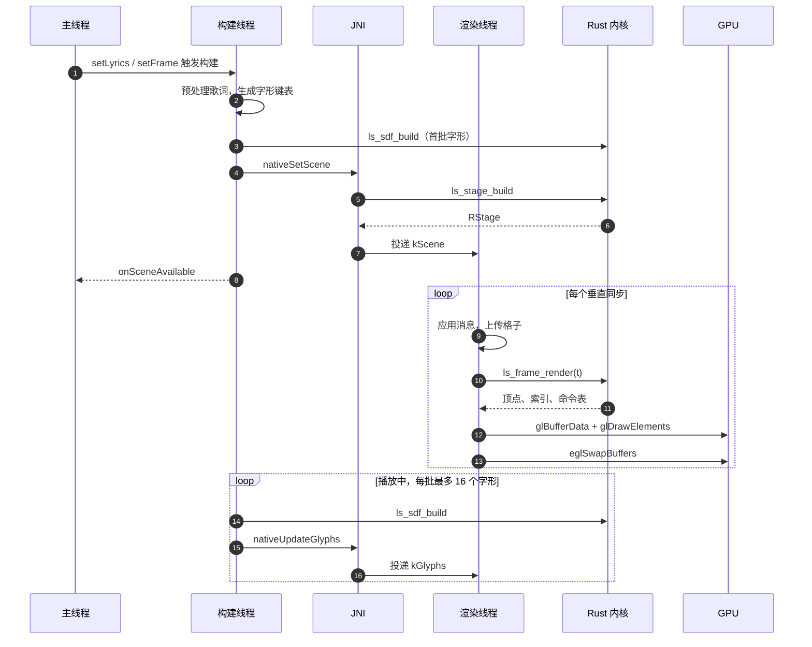

| 线程 | 创建方 | 优先级 | 工作内容 |
| --- | --- | --- | --- |
| 主线程 | 系统 | — | `setLyrics` / `setBeats` / `setSceneKind` / `setFrame` / `setMorph` / `setEdges` / `setClock` / `setActive`；接收 Surface 回调 |
| 构建线程 `LyricStageScene` | `Executors.newSingleThreadExecutor` | 构建时 `THREAD_PRIORITY_DISPLAY`，流式上传时 `THREAD_PRIORITY_BACKGROUND` | 歌词预处理、字形测量与栅格化、距离场生成、调用 `nativeSetScene` / `nativeUpdateGlyphs` |
| 渲染线程 | `StageRenderer` 构造时启动 `std::thread` | 默认 | `ALooper` 消息循环 + `AChoreographer` 帧回调；应用消息、上传纹理、调用 Rust 出帧、提交 GL 命令、`eglSwapBuffers` |
| 频段回调 | `AudioBandPulse` | — | 输出级低 / 中 / 高三段电平，换算为节奏脉冲后写入原子变量 |

线程间只通过以下方式通信：

- 互斥锁保护的消息队列（`Op`）；
- 原子变量（时钟以外的标量状态）；
- 时钟专用互斥锁；
- `ALooper_wake` 唤醒。

渲染线程不访问主线程，也不访问 HWUI 的 RenderThread。

## 3. 场景构建流程（每首歌一次）

触发条件：

- 歌词变化；
- 场景模式变化；
- 视图尺寸或文字安全区变化。

同一首歌只换尺寸时，场景原地替换，不做淡入。

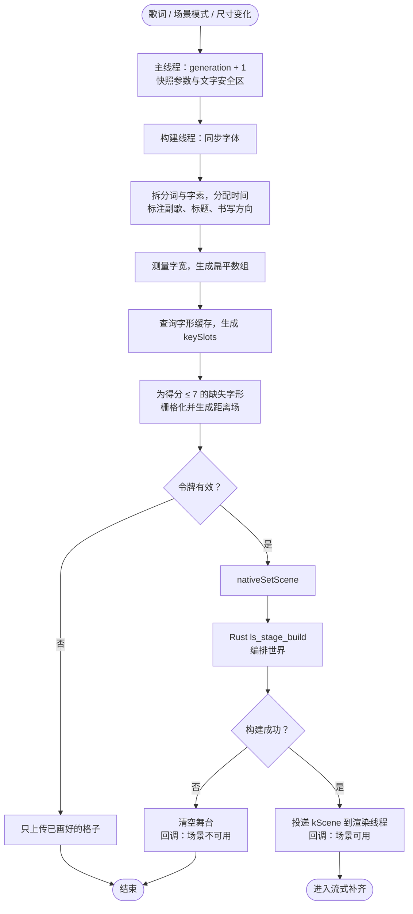

| 步骤 | 线程 | 输入 | 处理 | 输出 |
| --- | --- | --- | --- | --- |
| 1. 快照 | 主线程 | 当前歌词、标题、节拍网格、尺寸、安全区、场景模式 | 递增 `generation`，生成本次构建的令牌；计算文字可用的上下边界 | 构建任务 |
| 2. 字体同步 | 构建线程 | 当前应用字体 | 字体变化时清空字形缓存与字宽缓存 | — |
| 3. 歌词预处理 | 构建线程 | `LyricStageLine` 列表 | 用 `BreakIterator` 拆出词与字素，空格归入前一个词；有逐字时间时按词时间分配到码点，否则均分；判定副歌（重复行）与标题行；标注每个字素的书写方向类别（横排字母 / 竖排 CJK / 跟随邻字 / CJK 标点）；测量字宽 | `LyricStagePrepared`：字形键表、每行用到的键、扁平数组 |
| 4. 键到格子映射 | 构建线程 | 字形键表 | 在常驻字形缓存中查找已有格子，未命中记为 -1 | `keySlots` |
| 5. 首批字形 | 构建线程 | 当前播放位置所在行 | 为即将显示的几行补齐字形（见第 4 节） | 格子编号 + 距离场像素 |
| 6. 令牌校验 | 构建线程 | `generation` | 若已被新的构建取代，只上传已画好的格子（缓存已计入），丢弃场景 | — |
| 7. 提交场景 | 构建线程 → JNI | 扁平数组、节拍网格、场景模式、`keySlots`、首批格子 | JNI 拷贝参数，调用 Rust `ls_stage_build` 编排世界，打包为 `kScene` 消息投递到渲染线程 | `RStage` |
| 8. 结果回调 | 主线程 | 构建成功与否 | `SceneListener.onSceneAvailable` | 播放器决定显示舞台还是封面 |
| 9. 流式补齐 | 构建线程（后台优先级） | 剩余缺失字形 | 见第 4 节 | `kGlyphs` 消息 |

传给 Rust 的扁平数组：

| 数组 | 长度 | 内容 |
| --- | --- | --- |
| `lineWordStart` | 行数 + 1 | 每行第一个词的下标 |
| `wordGlyphStart` | 词数 + 1 | 每个词第一个字形的下标 |
| `lineTimes` | 2 × 行数 | 每行开始、结束时间（秒） |
| `lineFlags` | 行数 | 0 普通，1 副歌，2 标题 |
| `glyphData` | 5 × 字形数 | 字形键（空格为 -1）、字宽（em）、开始时间、结束时间、书写方向类别 |
| `beats` / `bars` | 可为空 | 节拍与小节起点（秒，已扣除歌词延迟） |

Rust 侧 `ls_stage_build` 依次完成：

1. 参数校验；
2. 把扁平数组还原为行 / 词 / 字形结构；
3. 按场景模式编排世界：确定每句歌词的位置、朝向和出现时间，以及立体空间与平面页面之间的切换点；
4. 确定视口、焦距与图集参数。

编排只计算位置和时间，不生成任何像素。

## 4. 字形图集流程

| 项 | 值 |
| --- | --- |
| 纹理 | 2048 × 4096，`GL_R8`，含完整 mip 链，`GL_LINEAR_MIPMAP_LINEAR` 采样，`CLAMP_TO_EDGE` |
| 格子 | 104 × 104 px，19 列 × 39 行，共 741 格 |
| 字号 | 80 px（1 em），字形水平居中，基线位于格子中心下方 0.36 em |
| 距离场范围 | 12 px（0.5 为字形边缘，0 / 1 分别为外侧 / 内侧 12 px） |
| 生命周期 | 与渲染器相同，跨歌曲共享 |

单个字形的生成：

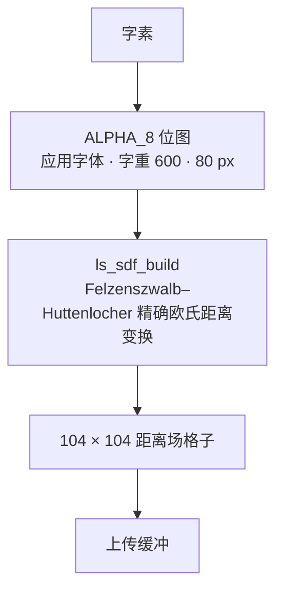

距离场以覆盖率作为初值，保留边缘的亚像素位置。

播放过程中的流式补齐：

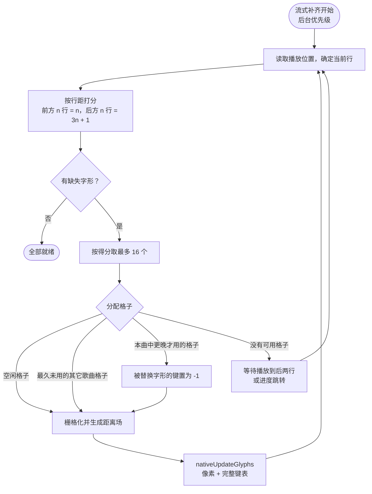

| 环节 | 规则 |
| --- | --- |
| 优先级 | 以当前行为基准：前方第 n 行得分 n，后方第 n 行得分 3n + 1；同一字形取最小得分 |
| 显示前 | 得分 ≤ 7 的缺失字形全部画好，与场景一起提交，保证首屏不缺字 |
| 播放中 | 后台优先级逐批补齐，每批 16 个，按得分从低到高；每批之前重新读取播放位置，进度跳转后立即跟随 |
| 分配 | 优先使用空闲格子；其次是最久未用、且不属于当前歌曲的格子；再次是当前歌曲中需要得最晚、且晚于本字形的格子，被替换字形的键同批改为 -1 |
| 图集已满 | 停止补齐，等播放位置到达后面第二行时再继续 |
| 上传 | 每次上传都附带完整的键到格子表，渲染端始终只引用已经有像素的格子 |

渲染线程处理上传：

1. 格子像素先写入内存镜像，并加入上传队列；
2. 下一帧开始时逐格 `glTexSubImage2D`，每批之后执行一次 `glGenerateMipmap`；
3. 键表在同一条消息中、像素之后生效；
4. 键为 -1 的字形本帧不绘制。

## 5. 渲染线程消息模型

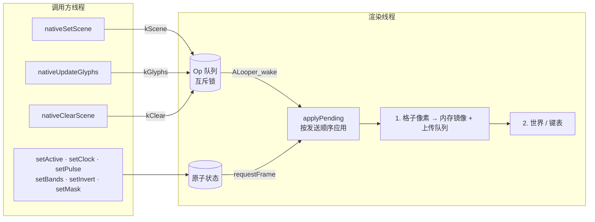

| 消息 | 携带内容 | 应用方式 |
| --- | --- | --- |
| `kScene` | `RStage`、序号、是否淡入、舞台尺寸、键表、格子像素 | 替换当前世界；淡入时记录淡入起点 |
| `kGlyphs` | 序号、可选键表、格子像素 | 像素总是生效；键表只在序号等于当前世界时生效 |
| `kClear` | — | 释放当前世界，之后绘制空舞台 |

消息按发送顺序在渲染线程依次应用。每条消息中先应用像素、再应用键表。其它状态直接写原子变量，写入后按需请求一帧：

- 激活状态；
- 时钟；
- 脉冲与频段；
- 反色；
- 遮罩参数。

## 6. 每帧渲染流程

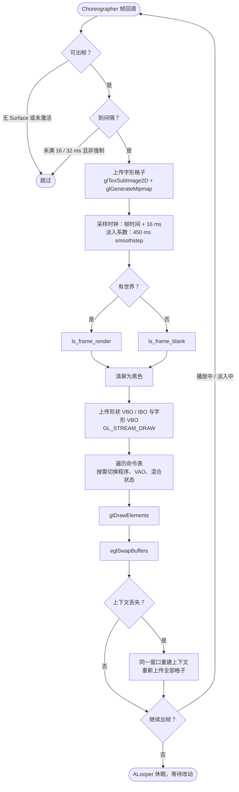

| 序号 | 阶段 | 说明 |
| --- | --- | --- |
| 1 | 帧回调 | `AChoreographer_postFrameCallback`，以显示器垂直同步为节拍 |
| 2 | 门控 | 无 Surface 或未激活时跳过；非强制帧时，若距上次绘制不足 16 ms（高帧率）或 32 ms（低帧率）也跳过 |
| 3 | 上传字形 | 处理上传队列（第 4 节） |
| 4 | 查询尺寸 | `eglQuerySurface` 取 Surface 宽高 |
| 5 | 采样时钟 | 当前帧时间加 16 ms 提前量（画面约在下一个垂直同步显示），换算为歌曲秒数 |
| 6 | 淡入系数 | 新世界在 450 ms 内从黑场淡入，`smoothstep` 曲线 |
| 7 | 写入频段 | `ls_frame_set_bands`（低 / 中 / 高） |
| 8 | Rust 出帧 | `ls_frame_render(t, pulse, fade, mask)`；没有世界时调用 `ls_frame_blank`，只输出底色与遮罩 |
| 9 | 清屏 | `glClearColor(0, 0, 0, 1)` |
| 10 | 上传几何 | 形状顶点、形状索引、字形顶点各一次 `glBufferData(GL_STREAM_DRAW)` |
| 11 | 执行命令 | 遍历命令表，命令类型变化时才切换程序、VAO 与混合状态（第 8 节）；形状用 `glDrawElements` 加形状索引，字形用共享的四边形索引 |
| 12 | 交换 | `eglSwapBuffers`；上下文丢失时在同一窗口重建上下文与资源，并从内存镜像重新上传全部格子 |
| 13 | 继续调度 | 正在播放或淡入中时继续请求下一帧；否则只在有新改动时绘制一次，然后在 `ALooper_pollOnce(-1)` 中休眠 |

Rust 内核一帧内的处理与绘制顺序：

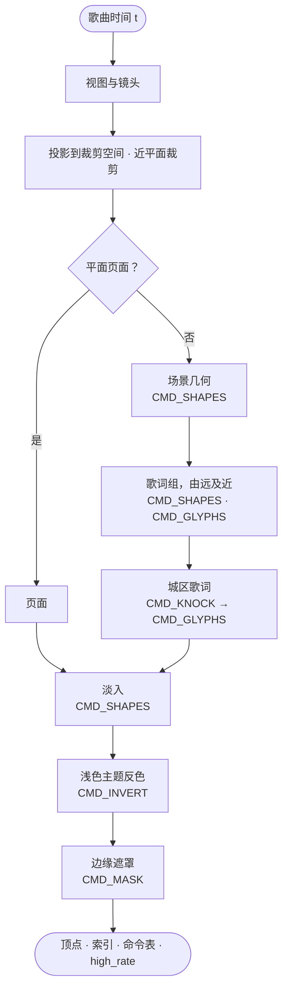

| 顺序 | 内容 | 命令 |
| --- | --- | --- |
| 1 | 场景几何（街道、建筑、粒子、节拍点阵等），线段与实心形状带羽化边 | `CMD_SHAPES` |
| 2 | 平面页面或立体空间中的歌词组，按深度由远及近 | `CMD_SHAPES` / `CMD_GLYPHS` |
| 3 | 城区场景的歌词：先压暗其后方，再绘制文字 | `CMD_KNOCK` → `CMD_GLYPHS` |
| 4 | 淡入遮罩（黑色全屏四边形，透明度为 1 − fade） | `CMD_SHAPES` |
| 5 | 浅色主题反色 | `CMD_INVERT` |
| 6 | 边缘遮罩（底部渐隐、左右渐隐） | `CMD_MASK` |

## 7. 着色器

一共两个程序。

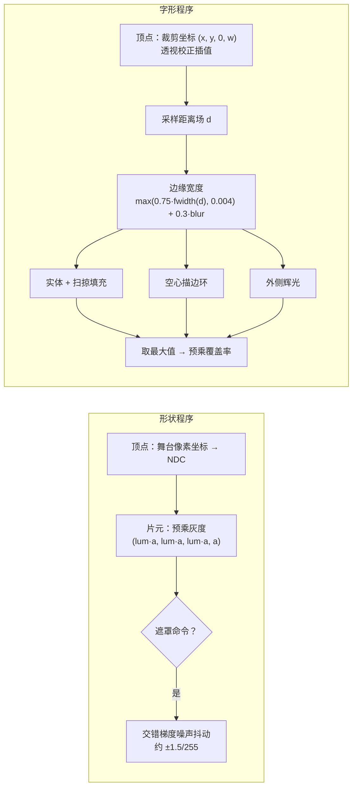

**形状程序**

| 阶段 | 输入 | 计算 | 输出 |
| --- | --- | --- | --- |
| 顶点 | 舞台像素坐标、亮度、透明度；`uSize` | 像素坐标换算为 NDC（y 轴翻转） | 亮度与透明度 |
| 片元 | 亮度、透明度；`uDither` | 输出预乘灰度 `(lum·a, lum·a, lum·a, a)`；遮罩命令开启抖动，按屏幕坐标生成交错梯度噪声，在半透明区间叠加约 ±1.5/255 的扰动，避免长渐变出现色带 | 颜色 |

**字形程序**

| 阶段 | 输入 | 计算 | 输出 |
| --- | --- | --- | --- |
| 顶点 | 裁剪坐标 (x, y, w)、图集 UV 与扫掠坐标、填充 / 描边 / 辉光 / 扫掠进度、失焦量 | `gl_Position = (x, y, 0, w)`，由 GPU 做透视校正插值 | 插值量 |
| 片元 | 图集采样值 d | 边缘宽度 = max(0.75·fwidth(d), 0.004) + 0.3·失焦量；实体 = smoothstep(0.5 − 宽度, 0.5 + 宽度, d)；扫掠：按字内坐标与扫掠进度求覆盖，用 fwidth 抗锯齿，实现逐字填充；空心描边：\|d − 0.5\| 附近的环；辉光：字形外侧随距离衰减；三者取最大值 | 预乘覆盖率（灰度） |

失焦通过加宽距离场边缘实现，辉光直接从距离场读出，不需要额外的模糊 pass。

## 8. 绘制命令与混合状态

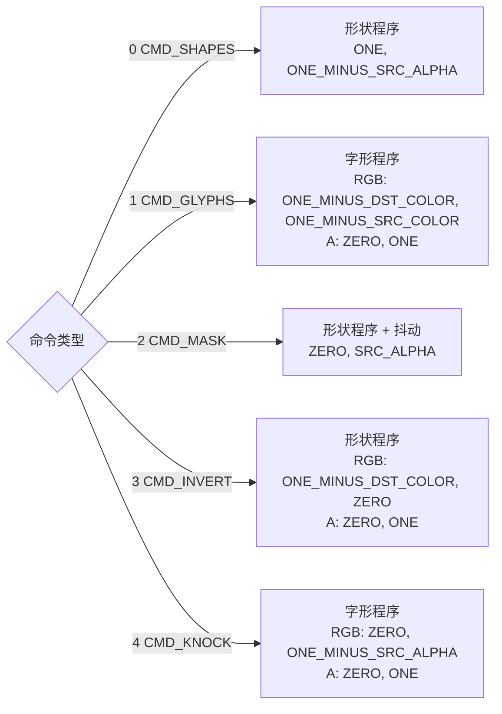

| 命令 | 值 | 程序 | RGB 混合 | Alpha 混合 | 用途 |
| --- | --- | --- | --- | --- | --- |
| `CMD_SHAPES` | 0 | 形状 | `ONE, ONE_MINUS_SRC_ALPHA` | 同左 | 预乘透明叠加：线段、实心形状、淡入 |
| `CMD_GLYPHS` | 1 | 字形 | `ONE_MINUS_DST_COLOR, ONE_MINUS_SRC_COLOR` | `ZERO, ONE` | 反相叠加：深色底上为白字，白色块上自动变为黑字 |
| `CMD_MASK` | 2 | 形状（抖动开） | `ZERO, SRC_ALPHA` | 同左 | 整幅画面乘以遮罩透明度，软边缘不需要 HWUI 图层 |
| `CMD_INVERT` | 3 | 形状 | `ONE_MINUS_DST_COLOR, ZERO` | `ZERO, ONE` | 浅色主题：一张全屏四边形把画面整体反色，透明度保持不变 |
| `CMD_KNOCK` | 4 | 字形 | `ZERO, ONE_MINUS_SRC_ALPHA` | `ZERO, ONE` | 压暗字形覆盖区域，避免文字与后方亮窗混在一起 |

全局状态：

- 关闭深度测试、背面剔除和 `GL_DITHER`；
- 开启混合。

## 9. 顶点与缓冲格式

| 结构 | 大小 | 字段 |
| --- | --- | --- |
| `ShapeV` | 16 B | `x, y`（舞台像素）、`lum`、`a` |
| `GlyphV` | 44 B | `x, y, w`（裁剪坐标）、`u, v`（图集坐标）、`lx`（字内扫掠坐标）、`fill`、`stroke`、`glow`、`sweep`、`blur` |
| `Cmd` | 12 B | `kind`、`first`、`count`；形状命令以索引计，字形命令以四边形计 |

| GL 对象 | 用途 | 更新频率 |
| --- | --- | --- |
| 形状 VBO / IBO | 每帧几何，16 位索引，单帧最多 64,000 个顶点 | 每帧 `GL_STREAM_DRAW` |
| 字形 VBO | 每帧字形四边形，单帧最多 16,000 个 | 每帧 `GL_STREAM_DRAW` |
| 四边形 IBO | 16,000 个四边形的固定索引（0-1-2, 0-2-3） | 创建时一次 `GL_STATIC_DRAW` |
| 形状 VAO / 字形 VAO | 两套属性布局 | 创建时一次 |
| 图集纹理 | 见第 4 节 | 按格子增量更新 |

## 10. 播放时钟同步

渲染线程维护一个本地时钟（锚点毫秒 + 锚点纳秒 + 速度），采用与滚动歌词相同的平滑规则，两者在同一时刻显示同一句。

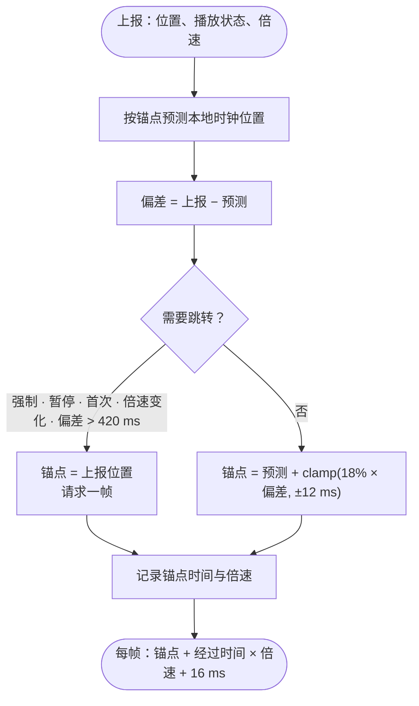

| 条件 | 处理 |
| --- | --- |
| 强制同步、暂停、首次上报、倍速变化、偏差超过 420 ms | 直接跳到上报位置，并请求一帧 |
| 其它情况 | 把偏差的 18% 计入锚点，单次修正最多 ±12 ms |
| 歌词延迟设置变化 | 强制同步 |

节拍网格传入时已扣除歌词延迟，与舞台时间使用同一时间轴。

## 11. 帧率与功耗策略

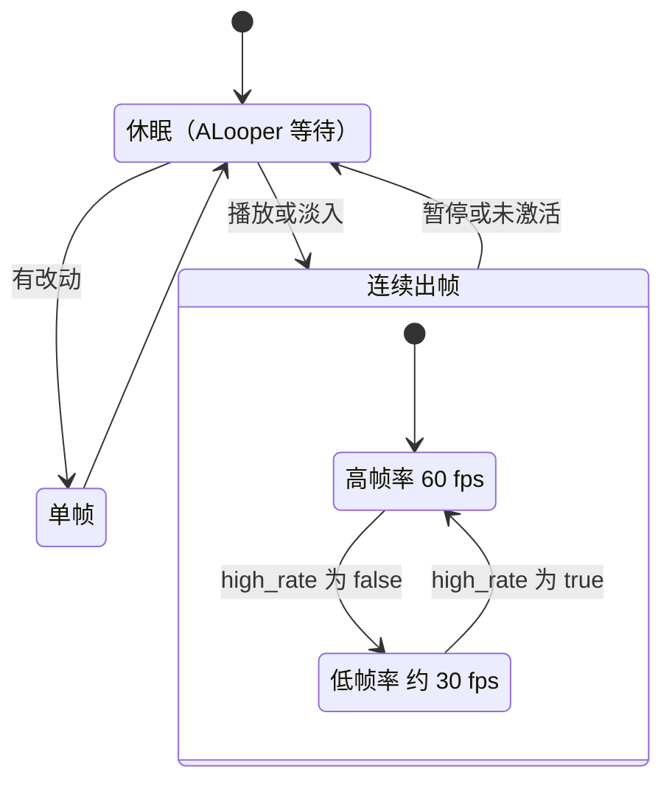

| 策略 | 实现 |
| --- | --- |
| 帧率上限 | 60 fps；间隔按 16 ms 判定，在 120 Hz 屏幕上稳定落在 60 |
| 降帧 | Rust 输出 `high_rate = false` 时（画面静止的页面），降为约 30 fps |
| 暂停 | 只画一帧，然后在消息循环中休眠，不使用定时器 |
| 未激活 | 视图不可见、应用在后台或播放器正在展开 / 收起时，`setActive(false)` 停止出帧 |
| GPU 负担 | 不使用 MSAA、深度 / 模板缓冲、离屏目标和全屏后处理；每帧只有少量 draw call |
| 交换 | `eglSwapInterval(0)`，由 Choreographer 控制节奏，交换时不阻塞 |
| CPU 负担 | 场景只编排一次；每帧只做投影与顶点生成；字形只在首次出现时栅格化，并跨歌曲复用 |

## 12. 与界面的合成

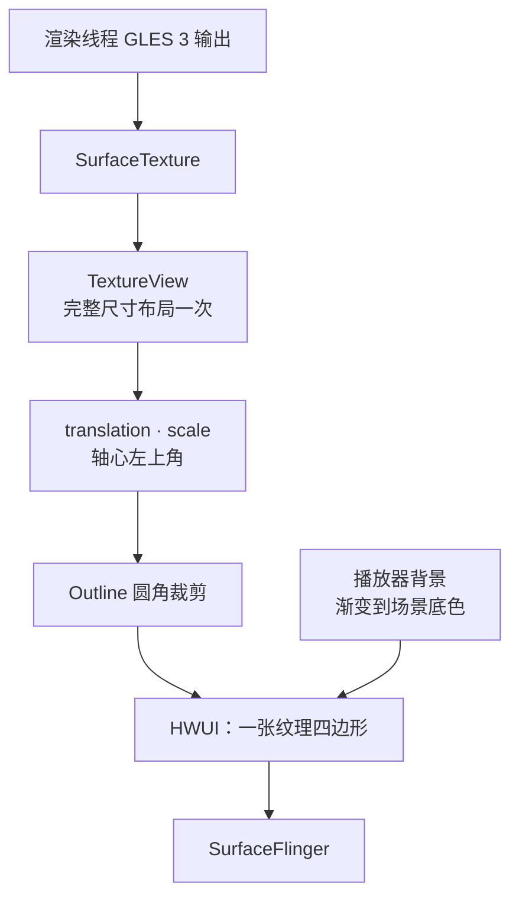

| 项 | 处理 |
| --- | --- |
| 承载视图 | `TextureView`，`isOpaque = false`，HWUI 中只是一张纹理四边形 |
| 布局 | 按展开后的完整尺寸布局一次；播放器展开 / 收起时只改 translation 与 scale（轴心在左上角），缓冲区不会重新分配 |
| 圆角 | `ViewOutlineProvider` 圆角矩形 + `clipToOutline`，半径按缩放比例换算 |
| 软边缘 | 在 GL 内用 `CMD_MASK` 完成（底部渐隐起止比例、左右渐隐宽度），不需要离屏图层 |
| 铺满到底边 | 遮罩进度为 0 时不做底部渐隐，文字仍停在指定的下边界之上 |
| 背景衔接 | 舞台显示时，播放器背景按舞台显示比例渐变到场景底色（深色主题为黑色，浅色主题为白色） |
| 浅色主题 | `CMD_INVERT` 整体反色，底色一同反转 |

## 13. Surface 与 EGL 生命周期

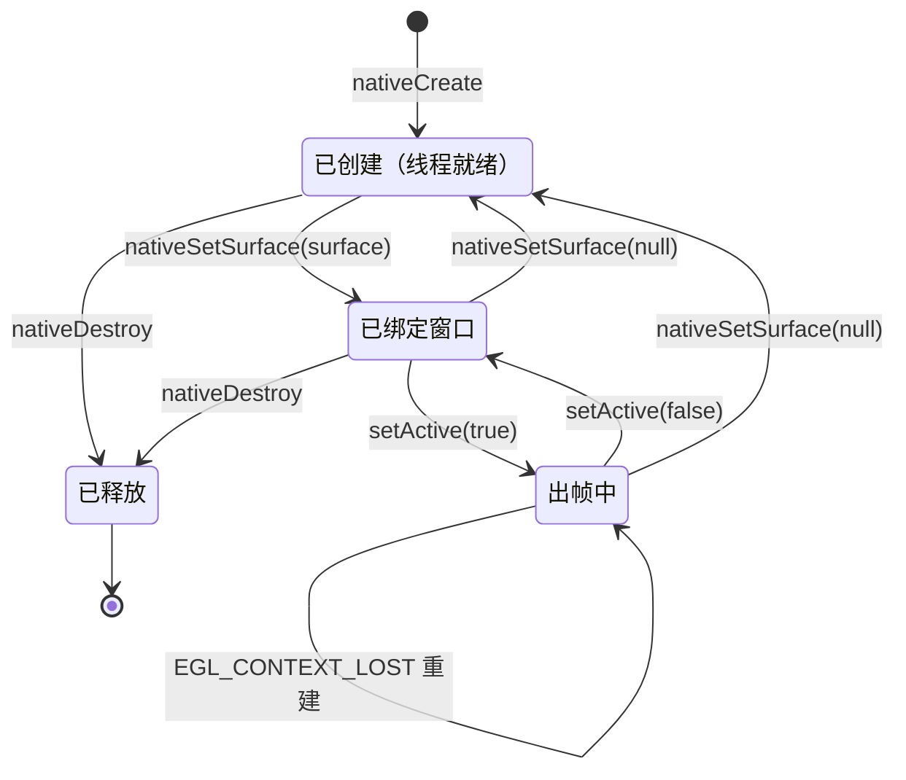

| 事件 | 处理 |
| --- | --- |
| 创建渲染器 | `nativeCreate`：启动渲染线程，等待消息循环就绪后返回；创建 Rust 帧对象 |
| Surface 可用 | `nativeSetSurface`：以票据方式交给渲染线程，调用方阻塞到渲染线程不再使用旧窗口（最长 2 s）；渲染线程按需初始化 EGL（ES 3、RGBA8888、无深度 / 模板 / 多重采样），创建窗口 Surface，编译程序，创建缓冲与纹理，再把内存镜像中的格子全部重新上传 |
| Surface 尺寸变化 | 下一帧通过 `eglQuerySurface` 读取新尺寸；在重新构建出新尺寸的场景之前，画面按比例缩放 |
| Surface 销毁 | `nativeSetSurface(null)`，渲染线程销毁 EGL Surface 并释放窗口 |
| 上下文丢失 | 交换时检测到 `EGL_CONTEXT_LOST`，在同一窗口重建 |
| 释放 | `release()`：令牌失效、停止出帧、注销频段回调；`nativeDestroy` 排在构建线程中所有任务之后执行；渲染线程退出前释放世界、未应用的消息、窗口与帧对象 |

## 14. 新功能窗口中的预览

首次启动时弹出的新功能窗口内嵌 `SuperDeepDemoView`。它直接使用 `LyricStageView` 与同一个原生渲染器。

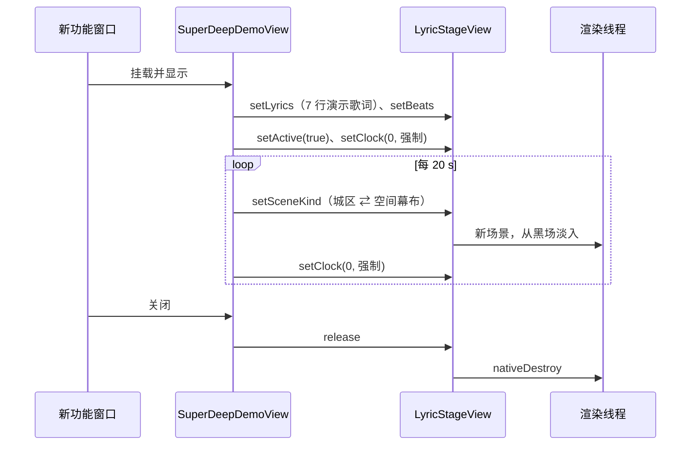

| 项 | 内容 |
| --- | --- |
| 演示歌词 | 7 行，时间固定，逐字演唱（文字带空格时逐词） |
| 节拍网格 | 节拍间隔 0.5 s，小节间隔 2 s |
| 场景 | 城区演示与空间幕布演示每 20 s 交替一次；每轮中第 3、4 行进入平面海报，经白块转场进出 |
| 循环 | 每轮把时钟强制归零，并以新场景从黑场淡入 |
| 尺寸 | 高度 = clamp(170 dp, 250 dp, 宽度 × 0.5)；舞台卡片宽度不超过高度的 2.3 倍，水平居中，圆角 20 dp |
| 主题 | 与应用一致，浅色时反色 |
| 运行条件 | 只在窗口已挂载且可见时播放，隐藏时停住 |
| 释放 | 窗口关闭（视图脱离窗口）时释放渲染线程、Surface 与图集 |
| 弹出条件 | 设备支持且功能尚未开启时才弹出；开启功能或勾选“不再提示”后不再出现 |

## 15. 异常与降级

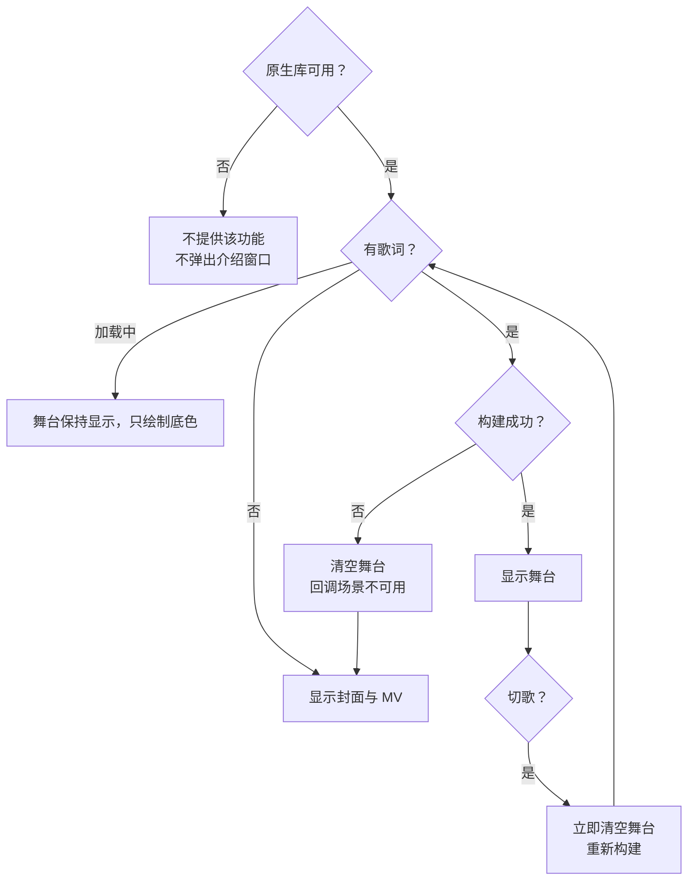

| 情况 | 处理 |
| --- | --- |
| 原生库缺失或加载失败 | `isSupportedOnDevice()` 返回 false，不提供该功能，也不弹出介绍窗口 |
| 当前歌曲没有可用歌词 | 场景不可用，播放器显示封面与 MV |
| 场景构建失败或内存不足 | 清空舞台，回调场景不可用 |
| 歌词加载中 | 舞台保持显示，只绘制底色，不回退到封面 |
| 切换到另一首歌 | 新歌词一到就清空舞台，不显示不属于当前歌曲的文字 |
| 图集已满 | 先保证即将显示的行，其余字形等播放位置接近时再补 |
